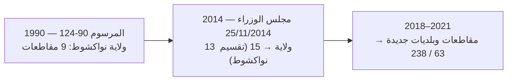

[English](README.md) | [Français](README.fr.md) | العربية

# 🇲🇷 mauritania-geo

**قاعدة البيانات الجغرافية والإدارية المرجعية لموريتانيا — بدون أي اعتماديات وقت التشغيل.**

*15 ولاية، 63 مقاطعة، و238 بلدية، مع عرض تاريخي للحدود (13 ولاية قبل 2014) وبحث عبر الصيغ اللغوية.*


---

## المحتويات
- [الميزات](#الميزات)
- [التغطية الإدارية](#التغطية-الإدارية)
- [التثبيت](#التثبيت)
- [البداية السريعة](#البداية-السريعة)
- [مرجع الواجهة البرمجية](#مرجع-الواجهة-البرمجية)
- [الخريطة الشعاعية و GeoJSON](#الخريطة-الشعاعية-و-geojson)
- [الحقب التاريخية (13 / 15)](#الحقب-التاريخية-13--15)
- [الملفات الجاهزة](#الملفات-الجاهزة)
- [جودة البيانات](#جودة-البيانات)
- [المصادر](#المصادر)
- [الترخيص](#الترخيص)

---

## الميزات

- 🇲🇷 **تغطية رسمية كاملة**: جميع **الولايات الـ15** و**المقاطعات الـ63** و**البلديات الـ238** (البنية السارية بعد تعديلات 2018/2021)، بأسماء عربية وفرنسية ورومنة ASCII.
- ⏳ **عرض تاريخي للحدود**: الاستعلام عن التقسيم **قبل 2014** — 13 ولاية مع ولاية نواكشوط الموحدة (`era=13`)، بما فيها المقاطعات التسع الحضرية المنشأة بموجب المرسوم رقم 90-124 (1990).
- 🔍 **بحث ضبابي عبر الصيغ**: يتجاوز التشكيل العربي وتغيّرات الهمزة والتاء المربوطة والتشكيل الفرنسي وعلامات الاقتباس والاختلافات الإملائية (`Bassiknou` = `Bassikounou` = `باسكنو`، `Guidimaka` = `Guidimakha`، `Kaedi` = `Kaédi`).
- ⚡ **صفر اعتماديات وقت التشغيل**: مكتبة قياسية بحتة مع فهارس في الذاكرة بسرعة O(1).
- 📦 **تكافؤ بين TypeScript و Python**: نفس الدوال والسلوك في النظامين (ESM + CommonJS + أنواع؛ بايثون مع `py.typed`).
- 🗺️ **خريطة SVG شعاعية و GeoJSON**: خريطة قابلة للنقر بسمات دلالية (`data-code`، `data-name-ar`، `data-name-fr`، `data-iso-code`) بإصدارين: 15 ولاية أو 63 مقاطعة.
- 🗄️ **تصدير بصيغ متعددة**: نصوص SQL جاهزة (PostgreSQL، SQLite، MySQL/MariaDB)، JSON مصغّرة، شجرة هرمية، وملفات CSV بصيغة UTF-8 (BOM).

> ℹ️ **لماذا لا توجد رموز هاتفية أو بريدية؟** موريتانيا **لا تستخدم رموز مناطق جغرافية** (خطة ترقيم وطنية واحدة موحّدة، +222، ببادئات المشغّلين: شنقيطل، ماتل، موريتل) و**لا يوجد نظام بريدي بالرموز** المستعمل على نطاق واسع. وكلا الأمرين موثّق أدناه.

---

## التغطية الإدارية

| المستوى | العدد | المعرّفات | الأسماء المتوفرة |
|---|:---:|---|---|
| **الولايات** | **15** | `01` – `15` (متوافقة مع ترقيم ISO 3166-2:MR) + `iso_code` (`MR-01`…`MR-15`) + رمز OCHA (`MR01`…`MR15`) | عربية، فرنسية، ASCII |
| **المقاطعات** | **63** | `0101` – `1512` (4 أرقام: الولاية + الرتب) + رمز OCHA | عربية (62/63)، فرنسية، ASCII |
| **البلديات** | **238** | `010101` – `151203` (6 أرقام: الولاية + المقاطعة + الرتب) + P-code المصدر | عربية (182/238)، فرنسية، ASCII |

> [!NOTE]
> كل قسم يحمل إحداثيات موثقة: **مراكز الأشكال** (`latitude`/`longitude`) لجميع المستويات، **إحداثيات العواصم** عند توفرها (`capital_latitude`/`capital_longitude`)، و**المساحة بالكيلومتر المربع** (`area_sqkm`). الأسماء العربية غير متوفرة لمقاطعة واحدة (Touil) و56 بلدية أُنشئت بعد 2018 — وتظهر هناك كـ `name_ar: null`.

---

## التثبيت

```bash
# Node.js / TypeScript
npm install mauritania-geo

# Python
pip install mauritania-geo
```

> [!TIP]
> الحزمتان منشورتان على npm وPyPI، لذا تعمل أوامر التثبيت أعلاه. يمكنك
> أيضًا التثبيت مباشرة من المصدر (البناء يتم تلقائيًا):
>
> ```bash
> git clone https://github.com/CheikhEbeoumar/mauritania-geo.git
> cd mauritania-geo
> npm install ./packages/typescript   # Node.js / TypeScript
> pip install ./packages/python       # Python
> ```
> راجع دليل النشر في [docs/PUBLISHING.md](docs/PUBLISHING.md).

---

## البداية السريعة

### TypeScript / JavaScript

```ts
import { getWilaya, getMoughataa, getCommune, getWilayaByCommune, search, toDropdownOptions } from "mauritania-geo";

const assaba = getWilaya("03"); // أو 3، أو "MR-03"، أو "العصابة"
console.log(assaba?.name_fr);            // "Assaba"
console.log(assaba?.name_ar);            // "العصابة"
console.log(assaba?.capital);            // "Kiffa"
console.log(assaba?.communes_count);     // 26

const m = getMoughataa("0304");
console.log(m?.name_fr, "/", m?.name_ar); // "Kankossa / كنكوصة"

console.log(getWilayaByCommune("130101")?.name_fr); // "Nouakchott-Ouest"

const r = search("Kaedi");
console.log(r.wilayas[0]?.item.name_fr); // "Gorgol"

const options = toDropdownOptions("ar"); // [{ value: "01", label: "الحوض الشرقي" }, …]
```

### Python

```python
import mauritania_geo as geo

wilaya = geo.get_wilaya("03")
print(wilaya.name_fr)           # Assaba
print(wilaya.name_ar)           # العصابة
print(wilaya.communes_count)    # 26

m = geo.get_moughataa("0304")
print(m.name_fr, m.name_ar)     # Kankossa كنكوصة

print(geo.get_wilaya_by_commune("140301", era=13).name_fr)  # Nouakchott
print(geo.get_wilaya_by_commune("140301", era=15).name_fr)  # Nouakchott-Nord

res = geo.search("Tidjikja")
print(res.wilayas[0].item.name_ar)  # تكانت
print(res.best.score)               # 1.0

import json
print(json.dumps(geo.get_commune("030501").to_dict(), ensure_ascii=False))

dropdown = geo.to_dropdown_options(lang="ar")  # [{'value': '03', 'label': 'العصابة'}, …]
```

---

## مرجع الواجهة البرمجية

| Python | TypeScript | الوصف |
|---|---|---|
| `get_wilaya(id, era=15)` | `getWilaya(id, era = 15)` | ولاية بالرمز (`3`، `"03"`، `"MR-03"`، `"MR03"`) أو الاسم |
| `get_wilayas(era=15)` | `getWilayas(era = 15)` | كل ولايات الحقبة (13 → قبل 2014) |
| `get_moughataa(code)` | `getMoughataa(code)` | مقاطعة برمز من 4 أرقام أو P-code |
| `get_moughataas(wilaya_code, era=15)` | `getMoughataas(wilayaCode, era = 15)` | مقاطعات ولاية |
| `get_all_moughataas()` | `getAllMoughataas()` | المقاطعات الـ63 |
| `get_commune(code)` | `getCommune(code)` | بلدية برمز من 6 أرقام أو P-code |
| `get_communes(wilaya_code, era=15)` | `getCommunes(wilayaCode, era = 15)` | بلديات ولاية |
| `get_all_communes()` | `getAllCommunes()` | البلديات الـ238 |
| `get_communes_by_moughataa(code)` | `getCommunesByMoughataa(code)` | بلديات مقاطعة |
| `get_moughataa_by_commune(code)` | `getMoughataaByCommune(code)` | مقاطعة بلدية |
| `get_wilaya_by_commune(code, era=15)` | `getWilayaByCommune(code, era = 15)` | ولاية بلدية |
| `search(query, limit=10)` | `search(query, { lang, limit })` | بحث ضبابي متعدد اللغات |
| `to_dropdown_options(lang, era)` | `toDropdownOptions(lang, era)` | خيارات `{ value, label }` لقوائم HTML |
| `get_map_svg(...)` | `getMapSvg(options?)` | خريطة SVG مستقلة (15 ولاية أو 63 مقاطعة) |
| `get_wilaya_svg_path(code, era)` | `getWilayaSvgPath(code, era)` | مسار SVG لولاية |
| `get_moughataa_svg_path(code)` | `getMoughataaSvgPath(code)` | مسار SVG لمقاطعة |
| `WILAYA_SVG_PATHS` / `MOUGHATAA_SVG_PATHS` | — | قاموس الرمز → مسار SVG |
| `get_dataset_meta()` | `getDatasetMeta()` | الأعداد والتغطية والمصادر والتاريخ |

---

## الخريطة الشعاعية و GeoJSON

ملفات جاهزة في [`dist/maps/`](dist/maps):

| الملف | الوصف |
|---|---|
| `mauritania-15.svg` / `.min.svg` | خريطة SVG للولايات الـ15 بتأثيرات التحويم |
| `mauritania-15.geojson` | أشكال الولايات (WGS84) |
| `mauritania-moughataas-63.geojson` | أشكال المقاطعات (WGS84) |

```python
import mauritania_geo as geo
svg = geo.get_map_svg()
svg63 = geo.get_map_svg(include_moughataas=True)
d = geo.get_wilaya_svg_path("03")
```

---

## الحقب التاريخية (13 / 15)



عند تمرير `era=13` تعكس جميع الاستعلامات خريطة **ما قبل 2014**، حيث كانت
نواكشوط ولاية سابعة عشرة موحّدة (`iso_code: "MR-NKC"` — الرمز الذي حذفته ISO
بتاريخ 27/11/2015):

```python
len(geo.get_moughataas("13", era=13))   # 9
geo.get_wilaya("Nouakchott", era=13).communes_count  # 9
```

---

## الملفات الجاهزة

| الملف | الصيغة | الوصف |
|---|:---:|---|
| `dist/wilayas.min.json` | JSON | مصفوفة الولايات الـ15 |
| `dist/moughataas.min.json` | JSON | مصفوفة المقاطعات الـ63 |
| `dist/communes.min.json` | JSON | مصفوفة البلديات الـ238 |
| `dist/tree.min.json` | JSON | شجرة هرمية كاملة |
| `dist/meta.json` | JSON | الأعداد والتغطية والمصادر |
| `dist/csv/*.csv` | CSV | تصدير UTF-8 (BOM) لإكسل |
| `dist/mauritania_geo.sql` | SQL | PostgreSQL & SQLite |
| `dist/mauritania_geo.mysql.sql` | SQL | MySQL 8 / MariaDB (`utf8mb4`) |
| `dist/maps/…` | SVG/GeoJSON | الخريطة والحدود |

---

## جودة البيانات

- **تيارت ↔ توجنين**: ملف المصدر (OCHA) يبدّل بلديتي هاتين المقاطعتين في
  نواكشوط الشمالية؛ صحّحنا الانتماء بناءً على ويكيبيديا (فرنسي/إنجليزي).
- **رموز بلديات نواكشوط**: تتبع مخططًا قديمًا (`MR013xx`) في المصدر؛ تُسنَد
  رموز مستقرة من 6 أرقام مع الاحتفاظ بالرمز الأصلي في `p_code`.
- **الإملاء الفرنسي**: اتبعنا الصيغ المعتمدة في ويكيبيديا الفرنسية
  وcitypopulation.de، مع إبقاء صيغ OCHA قابلة للبحث كأسماء بديلة.
- **الرموز الهاتفية**: لا توجد — خطة ترقيم وطنية واحدة (+222) ببادئات
  مشغّلين لا مناطق.
- **الرموز البريدية**: لا يوجد نظام وطني معمول به — لذا لا تُوفَّر.
- **تغطية الأسماء العربية**: 15/15 ولاية، 62/63 مقاطعة (الناقص: Touil)،
  182/238 بلدية — والمساهمات مرحّب بها.

---

## المصادر

1. **OCHA COD-AB** — «Mauritania - Subnational Administrative Boundaries»
   (data.humdata.org/dataset/cod-ab-mrt، نسخة يناير 2026): الهيكل والرموز
   والأشكال والمساحات والمراكز — **CC-BY 4.0**؛ الهندسة جزئيًا
   © OpenStreetMap (**ODbL 1.0**).
2. **ISO 3166-2:MR** — وكالة صيانة ISO، مع تحقق متقاطع من ويكيبيديا.
   نشرة ISO 2015-11-27: إضافة MR-13/14/15 وحذف MR-NKC.
3. **ويكيبيديا الفرنسية + citypopulation.de** — الصيغ الفرنسية المعتمدة
   والتحقق من بنية المقاطعات الـ63.
4. **ويكيبيديا العربية** — الأسماء العربية للولايات والمقاطعات والبلديات
   (CC-BY-SA 4.0).

المراسيم المرجعية: المرسوم رقم 90-124 بتاريخ 10/09/1990؛ مجلس الوزراء
بتاريخ 25/11/2014؛ مراسيم 2018/2021 المنشئة للمقاطعات والبلديات. راجع
[NOTICE](NOTICE) للتفاصيل.

---

## الترخيص

- **الشيفرة والمكتبات:** [MIT](LICENSE).
- **البيانات:** مجمّعة من OCHA COD-AB (**CC-BY 4.0**؛ الهندسة جزئيًا
  © مساهمو OpenStreetMap بموجب **ODbL 1.0**)، رموز ISO 3166-2، وويكيبيديا
  (**CC-BY-SA 4.0**). راجع [NOTICE](NOTICE).
