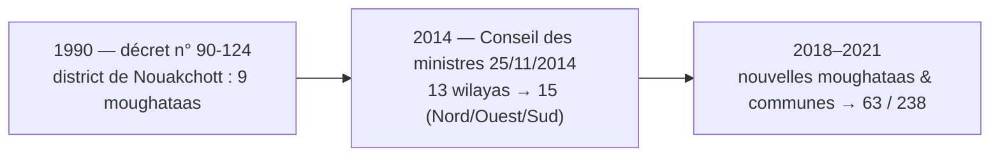

[English](README.md) | Français | [العربية](README.ar.md)

# 🇲🇷 mauritania-geo

**Le jeu de données géospatial et administratif de référence pour la Mauritanie, sans aucune dépendance d'exécution.**

*15 wilayas, 63 moughataas et 238 communes, avec une vue historique (13 wilayas, avant 2014) et une recherche multi-écritures.*


---

## Sommaire
- [Fonctionnalités](#fonctionnalités)
- [Couverture administrative](#couverture-administrative)
- [Installation](#installation)
- [Démarrage rapide](#démarrage-rapide)
- [Référence API](#référence-api)
- [Carte SVG interactive & GeoJSON](#carte-svg-interactive--geojson)
- [Époques historiques (13 / 15)](#époques-historiques-13--15)
- [Distributions de données](#distributions-de-données)
- [Qualité des données](#qualité-des-données)
- [Sources & provenance](#sources--provenance)
- [Compiler depuis les sources](#compiler-depuis-les-sources)
- [Licence](#licence)

---

## Fonctionnalités

- 🇲🇷 **Couverture officielle complète** : les **15 wilayas**, **63 moughataas** et **238 communes** (structure actuelle issue des réformes de 2018/2021), avec noms en français, arabe et romanisation ASCII.
- ⏳ **Vue historique** : l'organisation **d'avant 2014** — 13 wilayas avec le district de Nouakchott unifié (`era=13`), dont les 9 moughataas urbaines créées par le décret n° 90-124 (1990).
- 🔍 **Recherche floue multi-écritures** : gère les diacritiques arabes, les variantes d'hamza, les accents français, les apostrophes et les variantes orthographiques (`Bassiknou` = `Bassikounou` = `باسكنو`, `Guidimaka` = `Guidimakha`, `Kaedi` = `Kaédi`).
- ⚡ **Zéro dépendance d'exécution** : bibliothèque standard uniquement, recherches en mémoire en O(1).
- 📦 **Parité TypeScript / Python** : mêmes fonctions et mêmes résultats dans les deux écosystèmes (ESM + CommonJS + types ; Python typé avec `py.typed`).
- 🗺️ **Carte SVG vectorielle & GeoJSON** : carte cliquable avec attributs sémantiques (`data-code`, `data-name-ar`, `data-name-fr`, `data-iso-code`), en version 15 wilayas ou 63 moughataas.
- 🗄️ **Exports multi-formats** : dumps SQL (PostgreSQL, SQLite, MySQL/MariaDB), JSON minifiés, arborescence hiérarchique, CSV UTF-8 (BOM).

> ℹ️ **Pourquoi pas de codes téléphoniques ni postaux ?** La Mauritanie n'a **pas de préfixes géographiques** (plan de numérotation national fermé, +222, préfixes opérateurs : Chinguitel, Mattel, Mauritel) et **pas de système de codes postaux** d'usage courant. Ces deux points sont documentés plus bas.

---

## Couverture administrative

| Niveau | Nombre | Identifiants | Noms disponibles |
|---|:---:|---|---|
| **Wilayas** (ولاية) | **15** | `01` – `15` (aligné sur la numérotation ISO 3166-2:MR) + `iso_code` (`MR-01`…`MR-15`) + code OCHA (`MR01`…`MR15`) | arabe, français, ASCII |
| **Moughataas** (مقاطعة) | **63** | `0101` – `1512` (4 chiffres : wilaya + rang) + code OCHA | arabe (62/63), français, ASCII |
| **Communes** (بلدية) | **238** | `010101` – `151203` (6 chiffres : wilaya + moughataa + rang) + P-code source | arabe (182/238), français, ASCII |

> [!NOTE]
> Chaque division possède des coordonnées vérifiées : **centroïdes** (`latitude`/`longitude`) pour tous les niveaux, **coordonnées des chefs-lieux** quand disponibles (`capital_latitude`/`capital_longitude`) et **superficie en km²** (`area_sqkm`). L'arabe manque pour 1 moughataa (Touil) et 56 communes créées après 2018 — ces champs valent `name_ar: null`.

---

## Installation

```bash
# Node.js / TypeScript
npm install mauritania-geo

# Python
pip install mauritania-geo
```

> [!TIP]
> Les deux paquets sont publiés sur npm et PyPI : les commandes
> d'installation ci-dessus fonctionnent. Vous pouvez aussi installer
> directement depuis les sources (les builds sont automatiques) :
>
> ```bash
> git clone https://github.com/CheikhEbeoumar/mauritania-geo.git
> cd mauritania-geo
> npm install ./packages/typescript   # Node.js / TypeScript
> pip install ./packages/python       # Python
> ```
> La procédure de publication est décrite dans [docs/PUBLISHING.md](docs/PUBLISHING.md).

---

## Démarrage rapide

### TypeScript / JavaScript

```ts
import { getWilaya, getMoughataa, getCommune, getWilayaByCommune, search, toDropdownOptions } from "mauritania-geo";

const assaba = getWilaya("03"); // ou 3, "MR-03", "العصابة"
console.log(assaba?.name_fr);            // "Assaba"
console.log(assaba?.capital);            // "Kiffa"
console.log(assaba?.communes_count);     // 26

const m = getMoughataa("0304");
console.log(m?.name_fr, "/", m?.name_ar); // "Kankossa / كنكوصة"

console.log(getWilayaByCommune("130101")?.name_fr); // "Nouakchott-Ouest"

const r = search("Kaedi");
console.log(r.wilayas[0]?.item.name_fr); // "Gorgol"

const options = toDropdownOptions("ar"); // [{ value: "01", label: "الحوض الشرقي" }, …]
```

### Python

```python
import mauritania_geo as geo

wilaya = geo.get_wilaya("03")
print(wilaya.name_fr)           # Assaba
print(wilaya.name_ar)           # العصابة
print(wilaya.communes_count)    # 26

m = geo.get_moughataa("0304")
print(m.name_fr, m.name_ar)     # Kankossa كنكوصة

print(geo.get_wilaya_by_commune("140301", era=13).name_fr)  # Nouakchott
print(geo.get_wilaya_by_commune("140301", era=15).name_fr)  # Nouakchott-Nord

res = geo.search("Tidjikja")
print(res.wilayas[0].item.name_ar)  # تكانت
print(res.best.score)               # 1.0

import json
print(json.dumps(geo.get_commune("030501").to_dict(), ensure_ascii=False))

dropdown = geo.to_dropdown_options(lang="ar")  # [{'value': '03', 'label': 'العصابة'}, …]
```

---

## Référence API

| API Python | API TypeScript | Description |
|---|---|---|
| `get_wilaya(id, era=15)` | `getWilaya(id, era = 15)` | Wilaya par code (`3`, `"03"`, `"MR-03"`, `"MR03"`) ou nom |
| `get_wilayas(era=15)` | `getWilayas(era = 15)` | Toutes les wilayas de l'époque (13 → avant 2014) |
| `get_moughataa(code)` | `getMoughataa(code)` | Moughataa par code à 4 chiffres ou P-code |
| `get_moughataas(wilaya_code, era=15)` | `getMoughataas(wilayaCode, era = 15)` | Moughataas d'une wilaya |
| `get_all_moughataas()` | `getAllMoughataas()` | Les 63 moughataas |
| `get_commune(code)` | `getCommune(code)` | Commune par code à 6 chiffres ou P-code |
| `get_communes(wilaya_code, era=15)` | `getCommunes(wilayaCode, era = 15)` | Communes d'une wilaya |
| `get_all_communes()` | `getAllCommunes()` | Les 238 communes |
| `get_communes_by_moughataa(code)` | `getCommunesByMoughataa(code)` | Communes d'une moughataa |
| `get_moughataa_by_commune(code)` | `getMoughataaByCommune(code)` | Moughataa d'une commune |
| `get_wilaya_by_commune(code, era=15)` | `getWilayaByCommune(code, era = 15)` | Wilaya d'une commune |
| `search(query, limit=10)` | `search(query, { lang, limit })` | Recherche floue multilingue |
| `to_dropdown_options(lang, era)` | `toDropdownOptions(lang, era)` | Options `{ value, label }` pour `<select>` |
| `get_map_svg(...)` | `getMapSvg(options?)` | Carte SVG autonome (15 wilayas ou 63 moughataas) |
| `get_wilaya_svg_path(code, era)` | `getWilayaSvgPath(code, era)` | Chemin SVG (`d`) d'une wilaya |
| `get_moughataa_svg_path(code)` | `getMoughataaSvgPath(code)` | Chemin SVG (`d`) d'une moughataa |
| `WILAYA_SVG_PATHS` / `MOUGHATAA_SVG_PATHS` | idem | Correspondance code → chemin SVG |
| `get_dataset_meta()` | `getDatasetMeta()` | Comptages, couverture, sources, historique |

---

## Carte SVG interactive & GeoJSON

Fichiers pré-construits dans [`dist/maps/`](dist/maps) :

| Fichier | Description |
|---|---|
| `mauritania-15.svg` / `.min.svg` | Carte SVG des 15 wilayas (survol, attributs sémantiques) |
| `mauritania-15.geojson` | Polygones des wilayas (WGS84) |
| `mauritania-moughataas-63.geojson` | Polygones des moughataas (WGS84) |

```ts
import { getMapSvg, getWilayaSvgPath } from "mauritania-geo";
const svg = getMapSvg({ era: 15 });
const svg13 = getMapSvg({ era: 13 });                    // Nouakchott fusionné
const svg63 = getMapSvg({ includeMoughataas: true });    // 63 moughataas
```

```python
import mauritania_geo as geo
svg = geo.get_map_svg()
d = geo.get_wilaya_svg_path("03")
```

Exemple React :

```tsx
import { getWilayas, WILAYA_SVG_PATHS } from "mauritania-geo";

export function MauritaniaMap({ onSelect }: { onSelect: (code: string) => void }) {
  return (
    <svg viewBox="0 0 1000 1101">
      {getWilayas().map((w) => (
        <path key={w.code} d={WILAYA_SVG_PATHS[w.code]} data-code={w.code}
              onClick={() => onSelect(w.code)} />
      ))}
    </svg>
  );
}
```

---

## Époques historiques (13 / 15)



Avec `era=13`, toutes les requêtes reflètent la carte **d'avant 2014**, où
Nouakchott formait une seule 13ᵉ wilaya (`iso_code: "MR-NKC"`, code supprimé
par l'ISO le 27/11/2015) :

```python
len(geo.get_moughataas("13", era=13))   # 9
geo.get_wilaya("Nouakchott", era=13).communes_count  # 9
```

---

## Distributions de données

| Fichier | Format | Description |
|---|:---:|---|
| `dist/wilayas.min.json` | JSON | Tableau minifié des 15 wilayas |
| `dist/moughataas.min.json` | JSON | Tableau minifié des 63 moughataas |
| `dist/communes.min.json` | JSON | Tableau minifié des 238 communes |
| `dist/tree.min.json` | JSON | Arbre hiérarchique complet |
| `dist/meta.json` | JSON | Comptages, couverture, sources, historique |
| `dist/csv/*.csv` | CSV | Exports UTF-8 (BOM) pour Excel |
| `dist/mauritania_geo.sql` | SQL | PostgreSQL & SQLite |
| `dist/mauritania_geo.mysql.sql` | SQL | MySQL 8 / MariaDB (`utf8mb4`) |
| `dist/maps/…` | SVG/GeoJSON | Carte vectorielle et contours |

---

## Qualité des données

- **Teyarett ↔ Toujounine** : le fichier OCHA inverse les communes de ces deux
  moughataas de Nouakchott-Nord ; correction appliquée après vérification
  (Wikipédia fr/en, « Departments of Mauritania »).
- **P-codes de Nouakchott** : les P-codes de communes NKC du source suivent un
  schéma historique (`MR013xx`) ; la bibliothèque attribue des codes stables à
  6 chiffres et conserve le P-code brut dans `p_code`.
- **Orthographe** : les graphies canoniques suivent Wikipédia francophone et
  citypopulation.de (`Chinguetti`, `Bassikounou`, `Monguel`, `Magta-Lahjar`,
  `Mal`, `Tékane`, `F'Derick`, `Zouerate`, `Bir Moghreïn`, `Keur Macène`,
  `Kankossa`, `Barkewol`…) ; les graphies OCHA restent cherchables comme
  alias.
- **Téléphonie** : aucun préfixe géographique (plan national unique +222,
  préfixes opérateurs) — aucune fonction de recherche par code téléphonique.
- **Codes postaux** : aucun système national d'usage courant — non fournis.
- **Couverture arabe** : 15/15 wilayas, 62/63 moughataas (manque : Touil),
  182/238 communes.

---

## Sources & provenance

1. **OCHA COD-AB** — « Mauritania - Subnational Administrative Boundaries »
   (data.humdata.org/dataset/cod-ab-mrt, janvier 2026) : hiérarchie, P-codes,
   polygones, superficies, centroïdes, chefs-lieux — **CC-BY 4.0** ; géométrie
   en partie © OpenStreetMap (**ODbL 1.0**).
2. **ISO 3166-2:MR** — Agence de maintenance ISO 3166, recoupé avec
   Wikipédia (fr/en). Bulletin ISO 2015-11-27 : ajout de MR-13/14/15,
   suppression de MR-NKC.
3. **Wikipédia francophone + citypopulation.de** — graphies canoniques et
   vérification de la structure à 63 moughataas.
4. **Wikipédia arabe** — noms arabes (CC-BY-SA 4.0).

Textes de référence : décret n° 90-124 du 10/09/1990 ; Conseil des ministres
25/11/2014 ; décrets 2018/2021 créant moughataas et communes. Voir
[NOTICE](NOTICE).

---

## Compiler depuis les sources

```bash
python scripts/build.py --check          # validation seule
python scripts/build.py                  # build complet (dist/ + payloads)
# Ré-import depuis les fichiers OCHA bruts :
python scripts/import_source.py --raw-dir <dossier> && python scripts/build.py
```

Tests :

```bash
(cd packages/python && python -m unittest discover -s tests)
(cd packages/typescript && npm install && npm test)
```

---

## Licence

- **Code & bibliothèques :** [MIT](LICENSE).
- **Données :** OCHA COD-AB (**CC-BY 4.0** ; géométrie en partie
  © OpenStreetMap sous **ODbL 1.0**), codes ISO 3166-2, Wikipédia
  (**CC-BY-SA 4.0**). Voir [NOTICE](NOTICE).
