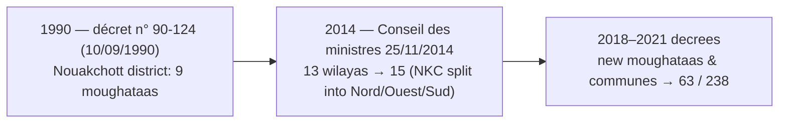

English | [Français](README.fr.md) | [العربية](README.ar.md)

# 🇲🇷 mauritania-geo

**The definitive, zero-runtime-dependency geospatial & administrative dataset for Mauritania.**

*15 Wilayas, 63 Moughataas, and 238 Communes with a historical boundary view (13 wilayas, pre-2014) and cross-script search.*


---

## Table of Contents
- [Features](#features)
- [Administrative Coverage](#administrative-coverage)
- [Installation](#installation)
- [Quick Start](#quick-start)
  - [TypeScript / JavaScript](#typescript--javascript)
  - [Python](#python)
- [API Reference](#api-reference)
- [Interactive SVG Map & GeoJSON](#interactive-svg-map--geojson)
- [Historical Eras (13 / 15)](#historical-eras-13--15)
- [Data Distributions](#data-distributions)
- [Data Quality Notes](#data-quality-notes)
- [Data Source & Provenance](#data-source--provenance)
- [Building from Source](#building-from-source)
- [Contributing](#contributing)
- [License](#license)

---

## Features

- 🇲🇷 **Complete Official Coverage**: all **15 wilayas**, **63 moughataas** and **238 communes** (current post-2018/2021 structure), with French, Arabic and ASCII-romanized names.
- ⏳ **Historical Boundary Era**: query the **pre-2014** map — 13 wilayas with a unified Nouakchott district (`era=13`), including the 9 urban moughataas created by décret n° 90-124 (1990) before the wilaya was split into Nord / Ouest / Sud (2014).
- 🔍 **Cross-Script Fuzzy Search**: folds Arabic diacritics/hamza variants/ta-marbuta, French accents, apostrophes and spelling variants (`Bassiknou` = `Bassikounou` = `باسكنو`, `Guidimaka` = `Guidimakha`, `Kaedi` = `Kaédi`).
- ⚡ **Zero Runtime Dependencies**: pure standard-library implementations with instant in-memory O(1) dictionary lookups.
- 📦 **Dual Ecosystem Parity**: identical feature set, function names (camelCase/snake_case) and behaviour in **TypeScript** (ESM + CommonJS + types) and **Python** (typed, `py.typed`).
- 🗺️ **Vector SVG Map & GeoJSON**: clickable, semantic SVG map with 15 wilayas *or* 63 moughataas (`data-code`, `data-name-ar`, `data-name-fr`, `data-iso-code`) and GeoJSON (WGS84) for Leaflet / Mapbox / D3 / QGIS.
- 🗄️ **Multi-Format Exports**: ready-to-import SQL dumps (PostgreSQL, SQLite, MySQL / MariaDB), minified JSON, hierarchical tree, and UTF-8 (BOM) CSVs.

> ℹ️ **Why no phone-code or postal-code lookups?** Unlike some other countries, Mauritania has **no geographic area codes** (a single closed national numbering plan, +222, with mobile prefixes per operator: Chinguitel, Mattel, Mauritel) and **no systematic postal code system**. Both facts were verified — see [Data Quality Notes](#data-quality-notes).

---

## Administrative Coverage

| Level | Count | Identifiers | Available Names |
|---|:---:|---|---|
| **Wilayas** (ولاية) | **15** | `01` – `15` (aligned with ISO 3166-2:MR numbering) + `iso_code` (`MR-01`…`MR-15`) + OCHA P-code (`MR01`…`MR15`) | Arabic, French, ASCII romanized |
| **Moughataas** (مقاطعة) | **63** | `0101` – `1512` (4-digit: wilaya + serial) + OCHA P-code (`MR011`…`MR153`) | Arabic (62/63), French, ASCII |
| **Communes** (بلدية) | **238** | `010101` – `151203` (6-digit: wilaya + moughataa + serial) + source P-code | Arabic (182/238), French, ASCII |

> [!NOTE]
> Names are provided in French (`name_fr`) and — where verified — Arabic (`name_ar`). `name_en` is an ASCII-safe romanization of the French name. Every division carries verified coordinates: **centroids** for all levels (`latitude`/`longitude`), **capital city coordinates** where available (`capital_latitude`/`capital_longitude`), and official **area in km²** (`area_sqkm`). Arabic is missing for 1 moughataa (Touil) and 56 mostly post-2018 communes without an Arabic Wikipedia presence — these carry `name_ar: null`; see [CONTRIBUTING](CONTRIBUTING.md) if you can help.

---

## Installation

### Node.js / TypeScript

```bash
# npm
npm install mauritania-geo
# pnpm
pnpm add mauritania-geo
# yarn
yarn add mauritania-geo
# bun
bun add mauritania-geo
```

### Python

```bash
# pip
pip install mauritania-geo
# uv
uv add mauritania-geo
# poetry
poetry add mauritania-geo
```

> [!TIP]
> Both packages are published on npm and PyPI, so the install commands above
> work. You can also install straight from source (both commands build
> automatically, no compilation step needed):
>
> ```bash
> git clone https://github.com/CheikhEbeoumar/mauritania-geo.git
> cd mauritania-geo
> npm install ./packages/typescript   # Node.js / TypeScript
> pip install ./packages/python       # Python
> ```
> The release flow is documented in [docs/PUBLISHING.md](docs/PUBLISHING.md).

---

## Quick Start

### TypeScript / JavaScript

Works seamlessly across Node.js, Bun, Deno, Next.js, Nuxt, Vite and browser bundlers:

```ts
import {
  getWilaya,
  getMoughataa,
  getCommune,
  getCommunes,
  getWilayaByCommune,
  search,
  toDropdownOptions,
} from "mauritania-geo";

// 1. Direct lookups by code or multilingual name
const assaba = getWilaya("03"); // or getWilaya(3), getWilaya("MR-03"), getWilaya("العصابة")
console.log(assaba?.name_fr);            // "Assaba"
console.log(assaba?.name_ar);            // "العصابة"
console.log(assaba?.capital);            // "Kiffa"
console.log(assaba?.communes_count);     // 26

// 2. Moughataa and commune lookups
const m = getMoughataa("0304");
console.log(m?.name_fr, "/", m?.name_ar); // "Kankossa / كنكوصة"
const c = getCommune("030501");
console.log(c?.name_fr, c?.latitude.toFixed(2), c?.longitude.toFixed(2)); // "Kiffa 16.63 -11.41"

// 3. Reverse lookup (which wilaya does a commune belong to?)
console.log(getWilayaByCommune("130101")?.name_fr); // "Nouakchott-Ouest"

// 4. Hierarchy listings
console.log(getCommunes("01").length);  // 37

// 5. Cross-script fuzzy search (French accents, OCHA spellings, Arabic…)
const r = search("Kaedi");              // no accent needed
console.log(r.wilayas[0]?.item.name_fr); // "Gorgol"
console.log(r.best?.score);              // 1.0

// 6. UI select dropdown options
const options = toDropdownOptions("ar");
// [{ value: "01", label: "الحوض الشرقي" }, { value: "02", label: "الحوض الغربي" }, …]
```

### Python

```python
import mauritania_geo as geo

# 1. Direct lookups by code or multilingual name
wilaya = geo.get_wilaya("03")  # accepts int or str: 3, "03", "MR-03", "العصابة"
print(wilaya.name_fr)           # "Assaba"
print(wilaya.name_ar)           # "العصابة"
print(wilaya.communes_count)    # 26

# 2. Moughataa and commune lookups
m = geo.get_moughataa("0304")
print(m.name_fr, m.name_ar)     # Kankossa كنكوصة
commune = geo.get_commune("030501")
print(commune.name_fr, commune.wilaya_code)  # Kiffa 03

# 3. Reverse lookup across the historical era
print(geo.get_wilaya_by_commune("140301", era=13).name_fr)  # Nouakchott
print(geo.get_wilaya_by_commune("140301", era=15).name_fr)  # Nouakchott-Nord

# 4. Cross-script fuzzy search
res = geo.search("Tidjikja")
print(res.wilayas[0].item.name_ar)  # تكانت
print(res.best.score)               # 1.0

# 5. JSON serialization for FastAPI / Django / Flask
import json
print(json.dumps(commune.to_dict(), ensure_ascii=False))

# 6. Dropdown options for web forms
dropdown = geo.to_dropdown_options(lang="ar")
# [{'value': '03', 'label': 'العصابة'}, …]
```

---

## API Reference

### Unified Query Functions

| Python API | TypeScript API | Description |
|---|---|---|
| `get_wilaya(id, era=15)` | `getWilaya(id, era = 15)` | Look up wilaya by code (`3`, `"03"`, `"MR-03"`, `"MR03"`) or name in Fr/Ar/En |
| `get_wilayas(era=15)` | `getWilayas(era = 15)` | List all wilayas of the boundary era (13 → pre-2014) |
| `get_moughataa(code)` | `getMoughataa(code)` | Look up a moughataa by 4-digit code or P-code |
| `get_moughataas(wilaya_code, era=15)` | `getMoughataas(wilayaCode, era = 15)` | List all moughataas of a wilaya |
| `get_all_moughataas()` | `getAllMoughataas()` | List all 63 moughataas |
| `get_commune(code)` | `getCommune(code)` | Look up a commune by 6-digit code or P-code |
| `get_communes(wilaya_code, era=15)` | `getCommunes(wilayaCode, era = 15)` | List all communes of a wilaya |
| `get_all_communes()` | `getAllCommunes()` | List all 238 communes |
| `get_communes_by_moughataa(code)` | `getCommunesByMoughataa(code)` | List communes within a moughataa |
| `get_moughataa_by_commune(code)` | `getMoughataaByCommune(code)` | Reverse lookup: moughataa of a commune |
| `get_wilaya_by_commune(code, era=15)` | `getWilayaByCommune(code, era = 15)` | Reverse lookup: wilaya of a commune |
| `search(query, limit=10)` | `search(query, { lang, limit })` | Multilingual fuzzy search across all levels |
| `to_dropdown_options(lang, era)` | `toDropdownOptions(lang, era)` | `{ value, label }` options for HTML selects |
| `get_map_svg(...)` | `getMapSvg(options?)` | Standalone SVG map (15 wilayas or 63 moughataas) |
| `get_wilaya_svg_path(code, era)` | `getWilayaSvgPath(code, era)` | SVG path (`d`) of a wilaya |
| `get_moughataa_svg_path(code)` | `getMoughataaSvgPath(code)` | SVG path (`d`) of a moughataa |
| `WILAYA_SVG_PATHS` | `WILAYA_SVG_PATHS` | Record wilaya code → SVG path |
| `MOUGHATAA_SVG_PATHS` | `MOUGHATAA_SVG_PATHS` | Record moughataa code → SVG path |
| `get_dataset_meta()` | `getDatasetMeta()` | Counts, coverage, sources, history |

### Search result shape

```jsonc
{
  "wilayas":   [{ "item": { … }, "score": 1.0 }],
  "moughataas":[{ "item": { … }, "score": 0.9 }],
  "communes":  [{ "item": { … }, "score": 0.9 }],
  "best":      { "item": { … }, "score": 1.0, "level": "wilaya" }
}
```

---

## Interactive SVG Map & GeoJSON

`mauritania-geo` ships a Web-Mercator vector map with semantic attributes
(`id="wilaya-01"`, `data-code`, `data-name-ar`, `data-name-fr`, `data-iso-code`,
`data-capital`, `data-moughataas`, `data-communes`) plus hover styling.

### Pre-built distributions (in `dist/maps/`)

| File | Description |
|---|---|
| `dist/maps/mauritania-15.svg` | Responsive SVG map, 15 wilayas, hover effects |
| `dist/maps/mauritania-15.min.svg` | Minified SVG for production |
| `dist/maps/mauritania-15.geojson` | Wilaya polygons (WGS84) — Leaflet/Mapbox/D3/QGIS |
| `dist/maps/mauritania-moughataas-63.geojson` | Moughataa polygons (WGS84) |

### TypeScript / JavaScript

```ts
import { getMapSvg, getWilayaSvgPath, WILAYA_SVG_PATHS } from "mauritania-geo";
// subpath import also supported:
// import { getMapSvg } from "mauritania-geo/map";

const svg = getMapSvg({ era: 15 });               // 15-wilaya map
const svg13 = getMapSvg({ era: 13 });             // pre-2014 (merged Nouakchott)
const svg63 = getMapSvg({ includeMoughataas: true }); // 63 moughataas
const d = getWilayaSvgPath("03");                 // "M497.5 305.7L494.0 303.5…"
```

### React / Next.js component example

```tsx
import { getWilayas, WILAYA_SVG_PATHS } from "mauritania-geo";

export function MauritaniaMap({ onSelect }: { onSelect: (code: string) => void }) {
  return (
    <svg viewBox="0 0 1000 1101">
      {getWilayas().map((w) => (
        <path key={w.code} d={WILAYA_SVG_PATHS[w.code]}
              data-code={w.code} onClick={() => onSelect(w.code)}>
          <title>{w.name_ar} — {w.name_fr}</title>
        </path>
      ))}
    </svg>
  );
}
```

### Python

```python
import mauritania_geo as geo

svg = geo.get_map_svg()                # 15 wilayas
svg63 = geo.get_map_svg(include_moughataas=True)
d = geo.get_wilaya_svg_path("03")
```

---

## Historical Eras (13 / 15)

Mauritania's administrative map changed in three well-documented steps:



By passing `era=13` every query reflects the **pre-2014** map, where
Nouakchott was a single 13th wilaya (`iso_code: "MR-NKC"`, the code deleted by
ISO on 2015-11-27):

```python
# era 13: the 9 Nouakchott moughataas live under wilaya "13"
len(geo.get_moughataas("13", era=13))   # 9
geo.get_wilaya("Nouakchott", era=13).communes_count  # 9
```

```ts
getMoughataas("13", 13).length;          // 9
getWilaya("14", 13)?.name_fr;            // "Nouakchott"
```

---

## Data Distributions

Pre-built files are in [`dist/`](dist):

| File | Format | Description |
|---|:---:|---|
| `dist/wilayas.min.json` | JSON | Minified array of the 15 wilayas |
| `dist/moughataas.min.json` | JSON | Minified array of the 63 moughataas |
| `dist/communes.min.json` | JSON | Minified array of the 238 communes |
| `dist/tree.min.json` | JSON | Nested tree: Wilayas ➔ Moughataas ➔ Communes |
| `dist/meta.json` | JSON | Counts, coverage, sources, history |
| `dist/csv/*.csv` | CSV | UTF-8 (BOM) exports for Excel / pipelines |
| `dist/mauritania_geo.sql` | SQL | DDL + INSERTs for PostgreSQL & SQLite |
| `dist/mauritania_geo.mysql.sql` | SQL | MySQL 8 / MariaDB script (`utf8mb4`) |
| `dist/maps/…` | SVG/GeoJSON | Vector map & boundaries (see above) |

---

## Data Quality Notes

- **Teyarett ↔ Toujounine**: the OCHA source file swaps the commune of these
  two Nouakchott-Nord moughataas; we verified against French/English Wikipedia
  that each commune belongs to the same-named moughataa and corrected it.
- **Nouakchott P-codes**: the source's commune P-codes for NKC follow a legacy
  scheme (`MR013xx`); this library assigns stable 6-digit codes and keeps the
  raw P-code in `p_code` for traceability.
- **Spelling conventions**: canonical French spellings follow French
  Wikipedia / citypopulation.de where they agree (`Chinguetti`, `Bassikounou`,
  `Monguel`, `Magta-Lahjar`, `Mal`, `Tékane`, `F'Derick`, `Zouerate`,
  `Bir Moghreïn`, `Keur Macène`, `Kankossa`, `Barkewol`…). OCHA/legacy
  spellings remain searchable as aliases.
- **Phone codes**: none — Mauritania uses one closed national numbering plan
  (+222, 8-digit NSN); prefixes identify the operator, not the region
  (per ITU/Wikipedia "Telephone numbers in Mauritania").
- **Postal codes**: none — Mauritania has no systematic national postal code
  scheme in public use, so none is provided.
- **Arabic coverage**: 15/15 wilayas, 62/63 moughataas (missing: Touil),
  182/238 communes. Everything else is `name_ar: null` — contributions
  welcome.

---

## Data Source & Provenance

The administrative boundaries, nomenclature, codes, areas and coordinates in
**mauritania-geo** are compiled and cross-verified from:

1. **OCHA COD-AB** — *"Mauritania - Subnational Administrative Boundaries"*
   (data.humdata.org/dataset/cod-ab-mrt, January 2026 version): hierarchy,
   P-codes, polygons, areas, centroids, capitals — **CC-BY 4.0**; underlying
   geometry partly © OpenStreetMap contributors (**ODbL 1.0**).
2. **ISO 3166-2:MR** — ISO 3166 Maintenance Agency (Online Browsing Platform),
   cross-checked with en/fr Wikipedia. ISO newsletter 2015-11-27 added
   MR-13/14/15 and deleted MR-NKC.
3. **French Wikipedia + citypopulation.de** — canonical French spellings and
   verification of the 63-moughataa structure (post-2018/2021 reforms).
4. **Arabic Wikipedia** — Arabic names of wilayas, moughataas and communes
   (CC-BY-SA 4.0).

Legal instruments referenced: décret n° 90-124 du 10 septembre 1990
(Nouakchott district, 9 moughataas); Conseil des ministres 25/11/2014 (split
of Nouakchott into 3 wilayas); 2018/2021 decrees creating new moughataas and
communes. See [NOTICE](NOTICE) for full attribution.

---

## Building from Source

```bash
# 1. Validate the committed canonical data
python scripts/build.py --check

# 2. Build all distributions (dist/) and regenerate package payloads
python scripts/build.py

# 3. Re-import from the raw OCHA COD-AB files (optional; needs the raw files)
#    Download mrt_admin{1,2,3_em}.geojson + mrt_admin{capitals,points}.geojson
#    from https://data.humdata.org/dataset/cod-ab-mrt into a folder, then:
python scripts/import_source.py --raw-dir <folder> && python scripts/build.py
```

Tests:

```bash
(cd packages/python && python -m unittest discover -s tests)
(cd packages/typescript && npm install && npm test)
```

---

## Contributing

Contributions are welcome! Please read [CONTRIBUTING.md](CONTRIBUTING.md) for
data citation guidelines and pull-request requirements — especially for
filling the remaining `name_ar` gaps.

---

## License & Legal Notices

- **Code & libraries:** [MIT License](LICENSE).
- **Data:** compiled from OCHA COD-AB (**CC-BY 4.0**; geometry partly
  © OpenStreetMap contributors under **ODbL 1.0**), ISO 3166-2 codes, and
  Wikipedia (**CC-BY-SA 4.0**). Attribution requirements flow through to
  users of the dataset — see [NOTICE](NOTICE).
